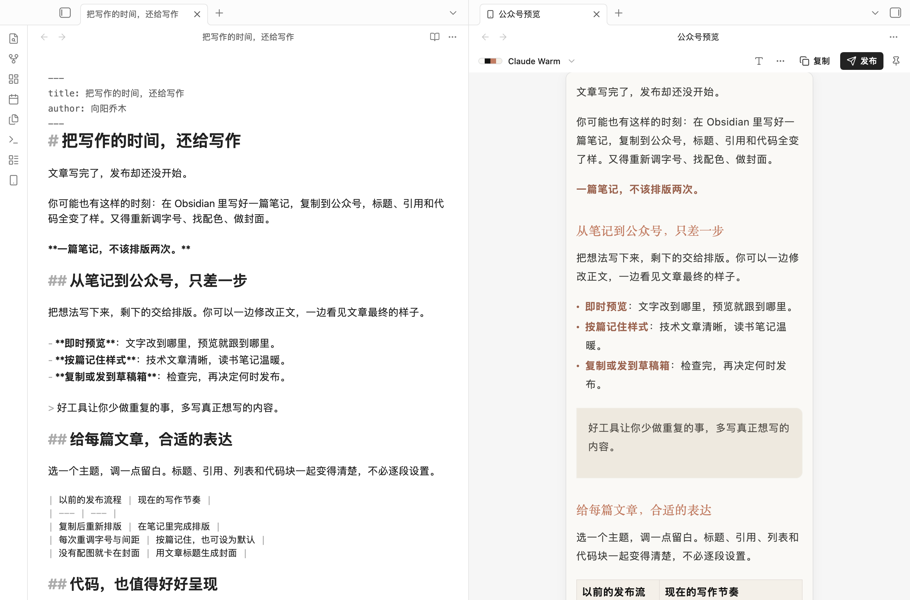
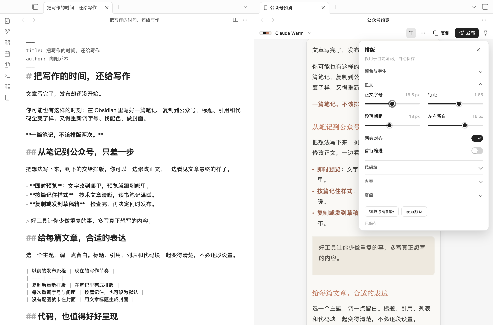
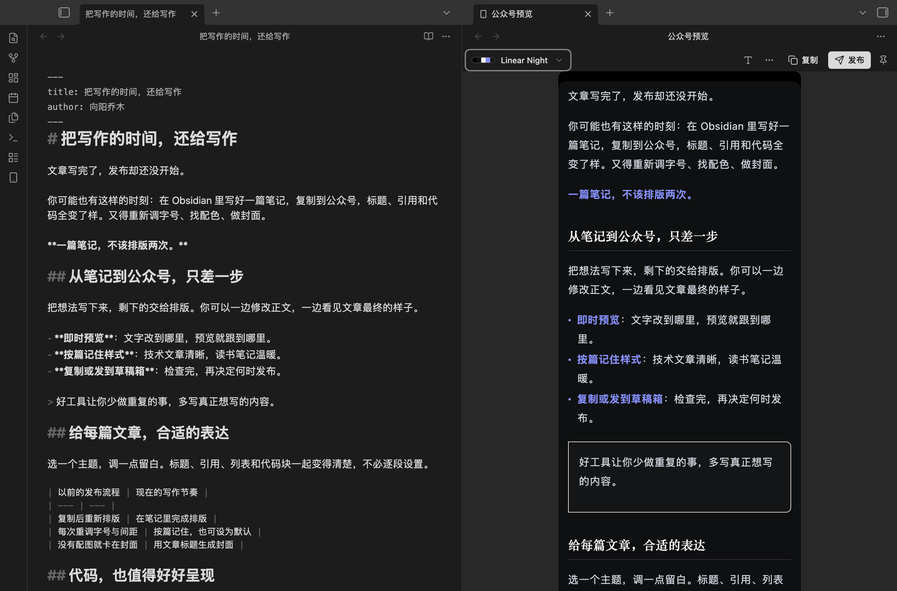
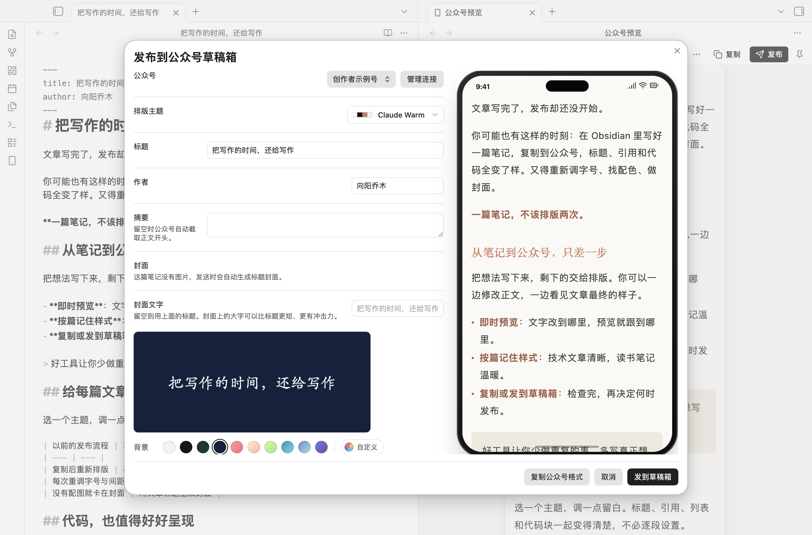

<div align="center">

# Qiaomu Publish

### 一篇笔记，不该排版两次。

**在 Obsidian 写好，预览排版，再交给公众号、X、知乎或小红书。**

Write in Obsidian. Preview, then prepare drafts for WeChat, X, Zhihu and Xiaohongshu.

**中文** · [English](README.en.md)

[](https://github.com/joeseesun/qiaomu-publish/releases/latest)
[](https://github.com/joeseesun/qiaomu-publish/actions/workflows/check.yml)
[](LICENSE)

[**从官方社区安装**](https://community.obsidian.md/plugins/qiaomu-publish) · [功能演示](#看看它怎么帮你) · [版本更新](https://github.com/joeseesun/qiaomu-publish/releases) · [反馈问题](https://github.com/joeseesun/qiaomu-publish/issues)

</div>



<p align="center"><sub>真实 Obsidian 截图 · 左边是你的笔记，右边是公众号排版。</sub></p>

你已经把文章写好了，却还得复制到另一个编辑器，重新调标题、行距、引用和代码，再找一张封面。

**Qiaomu Publish 把这些步骤留在写作现场。** 适合用 Obsidian 写公众号的作者、整理读书笔记的知识创作者，以及经常分享代码、公式和图表的人。笔记继续保存在自己的库里，排版按篇记住，下次接着写就好。

> **不连接公众号，也能先用。** 安装后打开一篇笔记，即可预览、调整排版、复制格式和导出文件。发送草稿时再配置账号。

## 安装

需要 **Obsidian 1.11.4 或更高版本**。

[**前往 Obsidian 官方社区安装 →**](https://community.obsidian.md/plugins/qiaomu-publish)

1. 打开官方页面，点击 **Add to Obsidian**，在 Obsidian 中选择 **安装 → 启用**。
2. 打开笔记，在命令面板运行 **「实时预览当前笔记的公众号排版」**。

也可以直接在 Obsidian 的「设置 → 第三方插件 → 浏览」中搜索 **Qiaomu Publish**，安装并启用。

后续更新可在「设置 → 第三方插件」中检查并安装，无需手动替换文件。

<details>
<summary>备用方式：手动安装</summary>

1. 从 [GitHub Releases](https://github.com/joeseesun/qiaomu-publish/releases/latest) 下载同一版本的 `main.js`、`manifest.json`、`styles.css`。
2. 在你的库中创建 `.obsidian/plugins/qiaomu-publish/`，将三个文件放进去。
3. 重启 Obsidian，在「设置 → 第三方插件」启用 **Qiaomu Publish**。

手动更新时替换这三个文件，保留 `data.json`。

</details>

## 看看它怎么帮你

### 01 / 写完就能看见文章的样子

42 个内置主题，从温暖的阅读风格到简洁的技术文档、深色排版。主题列表可搜索；正文、列表、引用、表格和代码一起变化。预览跟随笔记修改，支持同步滚动。

| 你可能遇到的麻烦 | 装上之后 |
| --- | --- |
| 复制出去，排版全乱了 | 在 Obsidian 先看效果，复制时带上同一份内联样式 |
| 每篇文章都从头调字号、间距 | 按篇保存，也能把满意的样式设为默认 |
| 纯文字文章卡在做封面 | 自动生成标题封面，文字、背景、字体都能调整 |
| 技术文章的代码、公式、图表难搬运 | 代码高亮与行号；MathJax 公式、Mermaid 图转成图片 |
| 改完又生成一份重复草稿 | 直连与乔木中转可更新笔记对应的原草稿 |
| 还想把文章发给朋友或存档 | 导出 HTML 或长图 PNG |

### 02 / 调整排版，直接看结果

点工具栏的 **「T」**，调整正文字号、行距、段落间距、左右留白、字体与主色。还可设置首行缩进、代码配色、行号、图片说明、链接脚注和自定义 CSS。



设置保存在插件里，只作用于当前笔记；正文和笔记属性不会因调整排版而被改写。重命名笔记或文件夹时，排版设置会一起保留。

<details>
<summary><strong>也可以是一篇安静的深色文章</strong></summary>



深色样式和公众号客户端的显示效果可能有差异，发送后请在公众号后台核对。

</details>

### 03 / 封面和草稿，在同一个窗口完成

没有配图的笔记会生成标题封面。可以单独写一句更短的封面文字，选择背景、字体、字号和颜色，再检查标题、作者、摘要和右侧预览。



<p align="center"><sub>真实插件界面，使用本地演示账号；截图不代表向真实公众号发送过文章。</sub></p>

有封面图片时，插件优先使用笔记的 `cover` / `封面` 属性，否则选取正文第一张图片。发送成功后，可把草稿 ID 记回笔记；再次发送默认更新原稿。**最终发布仍由你在公众号后台完成。**

### 04 / 一份内容，多种交付方式

- **复制公众号格式**：复制排版与嵌入的本地图片。粘贴到公众号编辑器后仍需检查图片；需要自动上传图片时请选择「发送草稿」。
- **发送草稿**：正文图片和封面通过所选账号连接上传。
- **导出 HTML**：带内联样式与嵌入图片，适合保存和分享。
- **导出长图 PNG**：适合发给朋友或作为文章预览。超长文章会降低分辨率，并给出提示。

支持 Obsidian 图片嵌入、Markdown 行内与引用式图片、库内 HTML 图片及嵌入笔记的附件。相同附件重复引用只上传一次；本地静态 SVG 自动转成 PNG。无法找到的图片会阻止复制、导出和发送，并提示修正引用。动画 SVG 会明确报错，请先导出为目标平台支持的动图格式；不需要动画时可导出 PNG。公众号正文图片接口只承诺 JPG / PNG，GIF 的实际接受情况仍需核对。

[查看这篇演示笔记导出的长图](docs/assets/article-export.png)。导出遇到无法读取的远程图片时会提示处理，避免悄悄漏图。

### 05 / 发到 X、知乎和小红书

桌面版发布窗口可切换平台，需要在同一台电脑的 Chrome 中安装 **Qiaomu Clipper 1.18.7 或更新版**，并登录所选平台。手机端保留公众号功能。

| 平台 | 插件准备的内容 | 交接后的状态 |
| --- | --- | --- |
| X 文章 | 可单独编辑的 Markdown、正文图片和封面 | 写入文章编辑器，检查后再发布；账号需有 X 文章权限 |
| 知乎 | 标题、正文、图片和题图 | 创建文章草稿，检查后再发布 |
| 小红书 | 3:4 图文卡片、标题、正文和话题 | 预填创作平台；请检查后点「暂存离开」或「发布」 |

封面支持从本机或笔记图片选择、裁剪，也可生成文字封面。X / 知乎窗口里的正文修改只作用于本次发送。小红书提供六种卡片模板，支持配色、分页和移除单张卡片；图文卡片是静态图片，GIF 动画不会保留在卡片中。X / 知乎的 GIF 在大小限制内保留原文件，超限时提示先压缩，不会悄悄转成 JPEG。

发送会打开系统默认浏览器。如果 Clipper 在另一个浏览器中，可在等待期间点「复制链接」，粘贴到已装扩展且已登录的平台浏览器。插件不代替你公开发布。

## 要发到草稿箱，再连接公众号

在发布窗口或「设置 → Qiaomu Publish → 公众号」添加连接。需要公众号的 **AppID、AppSecret、相应接口权限**，以及正确的 API IP 白名单。

| 连接方式 | 适合谁 | 需要准备 |
| --- | --- | --- |
| 固定 IP 的乔木中转 | 希望减少换网络后重配白名单的用户 | 按插件显示的出口 IP 配置白名单；凭据经 HTTPS 传到中转 |
| 当前设备直连 | 希望直接调用微信接口的用户 | 将设备当前公网出口 IP 加入白名单 |
| 自建 qmblog Bridge | 已有 Bridge 部署的用户 | Bridge 地址和访问令牌；当前只支持新建草稿 |

可以管理多个公众号，发送时明确选择目标。插件无法替账号开通微信接口权限；连接失败时会区分密钥、白名单、接口权限和服务错误。

<details>
<summary><strong>用笔记属性预填发布信息</strong></summary>

```yaml
---
title: 把写作的时间，还给写作
author: 向阳乔木
digest: 一篇笔记，从写作到公众号草稿。
wechat_theme: claude-warm
cover: "附件/文章封面.jpg"
cover_text: 把时间还给写作
source_url: https://example.com/article
---
```

`title/标题`、`author/作者`、`digest/摘要`、`cover/封面`、`cover_text/封面文字`、`wechat_account/公众号`、`wechat_theme/公众号主题`、`source_url/原文链接` 均可使用。`cover_text` 只影响自动生成的封面。

开启「记录到笔记属性」后，成功发送会写入 `wechat_media_id`、`wechat_draft_at` 和 `wechat_account`。样式优先级为：当前笔记保存的排版 → 笔记主题属性 → 插件默认。

</details>

## 你的内容与凭据

- 笔记、排版设置留在本地库中。AppSecret 和 Bridge 令牌使用 **Obsidian SecretStorage**，不写入同步的插件 `data.json`。
- 发送草稿会将正文、图片与封面交给所选连接。乔木中转会接收 AppID、AppSecret 和发布内容，以调用微信 API；它是可选连接方式。公开共享接入码不是私密凭据。
- X、知乎、小红书交接时，插件临时在 `127.0.0.1` 开启一个随机端口，只服务本次发送；Clipper 使用一次性凭证取得正文和图片，再在已登录的平台页面上传。任务结束即关闭端口，不使用公众号中转、不接收平台密码。浏览器链接中的一次性凭证在交接后移除，请勿分享等待中的交接链接。
- 预览中的远程图片会向原网站请求；导出会下载并嵌入远程图片。刷新白名单 IP、测试连接、读取 Bridge 账号和打开「关于」中的二维码也会联网。纯本地文字排版不需要网络。
- 首次启用且尚无本插件设置时，会只读同一库中旧版 Qiaomu Agent 的公众号配置来迁移，不改写 Agent 数据。
- 插件只发送草稿，不执行群发。音视频及网页嵌入需在公众号后台手动补充。自定义字体取决于阅读设备，不承诺所有手机显示相同字体。

## 验证与开发

0.2.0 已在隔离 macOS Obsidian 中检查预览、浅深色、窄面板、键盘调节、设置持久化、真实文件导出，以及从 0.1.2 的升级保留。草稿创建、更新与笔记写回使用本地受控服务验证；**不把它等同于真实微信账号验收**。iOS / Android 真机尚未覆盖。

```bash
npm ci
npm run check   # TypeScript、回归测试、生产构建
npm run dev     # 开发监听
```

[本地图片修复验收](docs/qa/2026-10-17-image-fix.md) · [0.2.0 验收记录](docs/qa/2026-10-17-release.md) · [第三方许可](THIRD_PARTY_NOTICES.md) · [提交问题](https://github.com/joeseesun/qiaomu-publish/issues/new)

## 作者

向阳乔木 · 公众号 **「向阳乔木推荐看」**

[工具](https://qiaomu.ai/) · [博客](https://blog.qiaomu.ai/) · [推荐](https://tuijian.qiaomu.ai/) · [X @vista8](https://x.com/vista8) · [GitHub](https://github.com/joeseesun)

[MIT License](LICENSE). 排版主题名称用于描述视觉风格，与相应品牌无关联。

---

## English

**Qiaomu Publish turns your Obsidian notes into formatted WeChat Official Account articles.** Keep writing in Markdown, preview the article beside your note, and choose whether to copy the formatted content, export a file, or send it to an account’s draft box. No account is needed for previewing, formatting, copying or exporting.

Choose from 42 searchable themes, adjust typography and spacing, and keep a different appearance for each note. Code highlighting, formula and Mermaid image conversion, generated title covers, standalone HTML and long PNG exports help reduce repetitive publishing work. Direct and Qiaomu relay connections can update the existing draft instead of creating duplicates.

Install from the [official Obsidian community listing](https://community.obsidian.md/plugins/qiaomu-publish): click **Add to Obsidian**, then **Install → Enable**. You can also search for **Qiaomu Publish** under **Settings → Community plugins → Browse**. Use Community plugins to check for future updates. Manual installation from [GitHub Releases](https://github.com/joeseesun/qiaomu-publish/releases/latest) remains available as a fallback. Obsidian 1.11.4 or later is required. The current plugin interface is Chinese.

Sending drafts requires an eligible WeChat Official Account, API credentials and IP allowlisting. Credentials use Obsidian SecretStorage; the optional relay receives them and article content over HTTPS. Remote images and explicit connection operations use the network. The plugin never mass-publishes articles.

Desktop checks include actual previews, exports, settings persistence and upgrade preservation. Draft creation and updates were tested against a controlled local service; live WeChat delivery and mobile hardware are not covered by those checks. Read the [full English guide](README.en.md) for installation, privacy, limitations and verification. MIT licensed.
